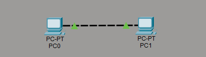
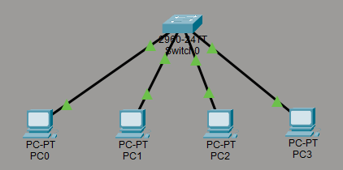
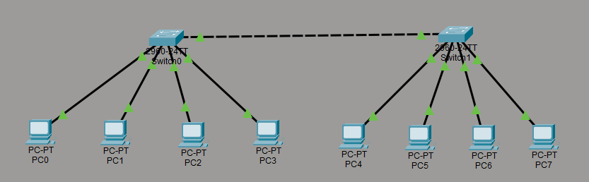
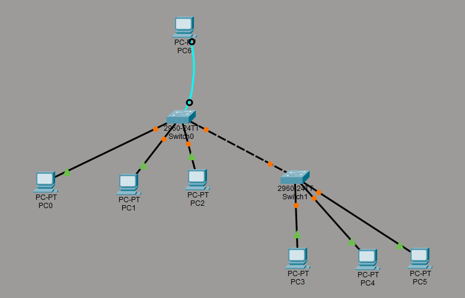

# Practical Networking Concepts
## Building and Managing a Layer 2 Network

### Story-Time 🔖

## 2 Friends started a Local-Startup 👤👤

#### Initially the customer count was less so they were able to handle all the requests, payments and every features on their respective desktops but for ease of sharing the data and resources they decided to connect them into LAN with Cables.

Topology :

    PC0 --- PC1

---
#### ⏱️ Months passed and they were able to reach a good amount of profit in the business and the demand of their product led them to increase the team which needed a switch so the data transfer becomes precise and confidential as well

Topology :

           Switch
              |
        |   |   |   |
       PC0 PC1 PC2 PC3

---
#### 🏢 Business grew more they went from Local Area Startup to a Full fledged Startup and this made them to grow their infra more for which they required another LAN network but connected at the same time so they just occupied the neighbouring office of their current office and made a setup their too and connected it with cables

           Switch1 ---------- Switch2
              |                 |
        |   |   |   |     |   |   |   |  
       PC0 PC1 PC2 PC3   PC4 PC5 PC6 PC7

---
#### 🛠️ The network grew quite well when compared to the initail setup of 3 PCs connected with cables, but this isn't sufficient as they wanted not only a well connected LAN but a well secured and well managed LAN.

### ⚙️ For this they introduced VLAN through managing the switch so they can just create logical separation between switch ports and separate the departments without any physical change. VLAN provided them No Extra Cost and Simple separation for LAN.

Topology :

            PC (as Console)
            |
           Switch1 ---------- Switch2
              |                 |
        |   |   |   |     |   |   |   |  
       PC0 PC1 PC2 PC3   PC4 PC5 PC6 PC7

##### ℹ️ Here the PC (as Console) was connected to Switch1 using their Console cable and ports which doesn't have IP stack so it's very different from a regular Ethernet cable and port. The console connection provides out-of-band management, allowing administrators to configure the switch through the Cisco IOS CLI without using the Ethernet network.

    RS 232 (PC) --- Console Port (Switch)
---
Their Final Network Looks like


---
## 🎯 Objectives Achieved

- Established communication between hosts
- Expanded the LAN using switches
- Connected multiple LAN segments
- Configured a managed switch
- Created VLAN-based logical separation
- Verified connectivity before and after VLAN implementation
---
## 🔖 Concepts Introduced

### 1. Ethernet Cables

#### Cross-Over Cable
Used to directly connect **similar devices** such as **PC ↔ PC** or **Switch ↔ Switch** (on older devices). It swaps the **Transmit (TX)** and **Receive (RX)** wire pairs, allowing both devices to communicate.

#### Straight-Through Cable
Used to connect **different devices** such as **PC ↔ Switch** or **Switch ↔ Router**. The transmit and receive pairs remain in the same order.

#### Console Cable
A special cable used for **out-of-band management** of network devices. It connects a **PC's RS-232 serial port** to a **switch/router console port**, allowing administrators to configure the device through the **Cisco IOS Command Line Interface (CLI)**. Unlike Ethernet cables, it **does not carry Ethernet frames, IP packets, or ICMP traffic**.

---

### 2. Switch

A **Layer 2 (Data Link Layer)** networking device that connects multiple hosts within the same **Local Area Network (LAN)**. It forwards **Ethernet Frames** based on **MAC Addresses**, enabling efficient communication between connected devices.
A Manageable switch is the one that provides administrative control through a **Command Line Interface (CLI)** or web interface. Unlike an unmanaged switch, it supports advanced features such as:

- VLAN Configuration
- Port Management
- Security Policies
- Monitoring and Diagnostics

---

### 3. VLAN (Virtual Local Area Network)

A **logical segmentation** of a physical network that divides a switch into multiple independent **broadcast domains**. Devices belonging to different VLANs cannot communicate directly unless **inter-VLAN routing** is configured using a Layer 3 device.

**Benefits**
- Improved Security
- Reduced Broadcast Traffic
- Better Network Organization
- No Additional Physical Infrastructure Required

---

### 4. Cisco IOS CLI

The **Cisco Internetwork Operating System (IOS)** provides a **Command Line Interface (CLI)** used to configure, monitor, and troubleshoot Cisco networking devices.

Some basic commands used in this session:

```bash
enable
configure terminal
show vlan
vlan 2
exit
int range fa0/13-24
switchport mode access
switchport access vlan 2
```

---

### 5. Static IP Addressing

Each PC was manually assigned an IPv4 address belonging to the same subnet (e.g., `192.168.0.0/24`). Since all hosts belonged to the same network, they were able to communicate without requiring a router.

---